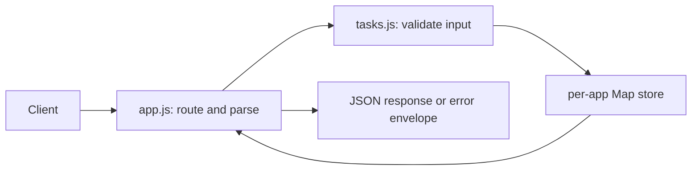

# Architecture and decisions

## Request flow

`server.js` owns process configuration, listening and signal handling. `app.js` returns an unbound Node HTTP server so tests can listen on an ephemeral port without spawning the production entrypoint. It translates expected `HttpError` exceptions to JSON and hides unexpected internal errors. The injected error callback makes the failure boundary testable without exposing stack traces to clients.

`tasks.js` owns field rules, query validation and a Map-backed repository. Every app receives a fresh store by default. Create/update/get/list return copies so consumers cannot accidentally mutate stored task objects. Fields are primitives, so shallow copies are sufficient. The injectable ID generator and clock make unit tests deterministic; normal instances use crypto.randomUUID and UTC ISO timestamps.

## Design choices

- **Native ESM JavaScript:** explicit imports, `type: module`, no framework or compiler on Day 1. This choice keeps HTTP, async streams, errors and module boundaries visible. TypeScript is planned later and is not currently implemented.
- **In-memory persistence boundary:** a closure hides the Map. Storage methods provide a replacement point for a future database, but they are synchronous today; a database adapter will require deliberate async changes and transaction/error semantics.
- **Validation at the write boundary:** every store write validates input, including non-HTTP callers. HTTP parsing separately enforces media type, valid JSON and a 16 KiB byte limit. Field lengths use JavaScript code units, not bytes or grapheme clusters.
- **Errors:** expected public failures carry status/code/message. Unexpected failures are logged by default and return a generic 500. No general logging/redaction system is claimed.
- **Filters:** O(n) scans with AND semantics; statistics perform bounded bucket scans over the selected set. This is adequate for a small exercise, not an indexed query engine.
- **Lifecycle:** SIGINT/SIGTERM stop accepting new requests; after five seconds active connections are forcibly closed. In-memory data is not saved during shutdown.

## Verification boundaries

Unit tests exercise rules, defaults, copy isolation, clocks, filtering and aggregation. Integration tests use actual HTTP on ephemeral loopback ports, covering CRUD, status codes, headers, parsing, body limits and sanitized failures. Syntax checks are not type checking. Coverage is reported, with no claim of full branch coverage or load/security testing. CI runs these checks on Linux with Node pinned in `.nvmrc`.

## Explicit limitations and next steps

One process owns one unbounded, volatile store. No durable database, users, authentication, authorization, rate limiting, pagination, request IDs, audit history, tracing, metrics, deployment infrastructure, container image or frontend exists. Concurrent database updates, idempotency and optimistic locking are future design work. Health is liveness only. API tests do not establish production readiness.

The root npm workspace currently contains one app. Add a frontend as another app and shared packages only when needed; workspace membership is explicit. Keep weekly learning evidence in docs rather than copying entire apps into each week.
